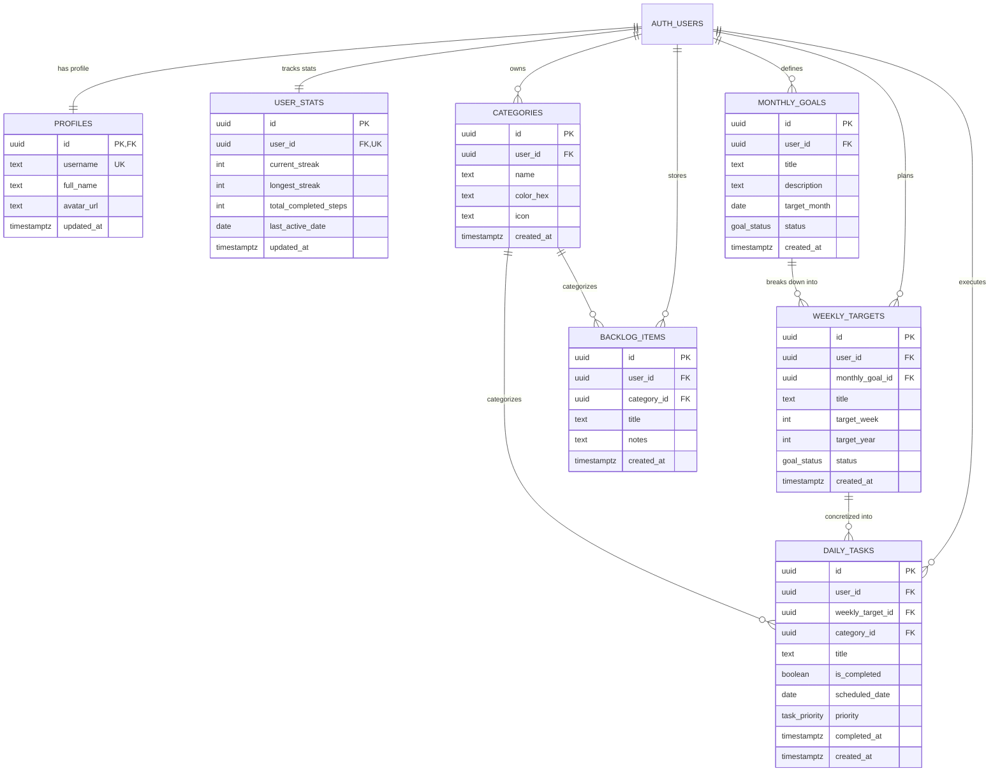

# Database Schema & Row Level Security (ERD) — Langkah

Dokumen ini mendefinisikan skema basis data PostgreSQL untuk backend **Supabase**, relasi antar-tabel, indeks performa, fungsi otomatis (*triggers*), dan aturan keamanan **Row Level Security (RLS)**.

---

## 1. Diagram Relasi Entitas (ERD)



---

## 2. Definisi Enums & Ekstensi

```sql
-- Ekstensi UUID
CREATE EXTENSION IF NOT EXISTS "uuid-ossp";

-- Enum Status Target (Goals & Targets)
CREATE TYPE goal_status AS ENUM ('pending', 'in_progress', 'completed');

-- Enum Prioritas Tugas Harian
CREATE TYPE task_priority AS ENUM ('low', 'medium', 'high');
```

---

## 3. Definisi Tabel (DDL)

### 3.1 `profiles`
Menyimpan identitas publik pengguna, terikat langsung dengan `auth.users`.
```sql
CREATE TABLE public.profiles (
    id UUID PRIMARY KEY REFERENCES auth.users(id) ON DELETE CASCADE,
    username TEXT UNIQUE NOT NULL,
    full_name TEXT,
    avatar_url TEXT,
    updated_at TIMESTAMPTZ DEFAULT timezone('utc'::text, now()) NOT NULL,
    CONSTRAINT username_min_length CHECK (char_length(username) >= 3)
);
```

### 3.2 `categories`
Kategori domain pertumbuhan (misal: *Coding*, *Fitness*, *Reading*, *Atomic Habits*).
```sql
CREATE TABLE public.categories (
    id UUID PRIMARY KEY DEFAULT gen_random_uuid(),
    user_id UUID NOT NULL REFERENCES auth.users(id) ON DELETE CASCADE,
    name TEXT NOT NULL,
    color_hex TEXT NOT NULL DEFAULT '#00897B',
    icon TEXT DEFAULT 'tag',
    created_at TIMESTAMPTZ DEFAULT timezone('utc'::text, now()) NOT NULL,
    CONSTRAINT unique_category_per_user UNIQUE(user_id, name)
);
```

### 3.3 `monthly_goals`
Sasaran makro bulanan (Peta Perencanaan Jangka Menengah).
```sql
CREATE TABLE public.monthly_goals (
    id UUID PRIMARY KEY DEFAULT gen_random_uuid(),
    user_id UUID NOT NULL REFERENCES auth.users(id) ON DELETE CASCADE,
    title TEXT NOT NULL,
    description TEXT,
    target_month DATE NOT NULL, -- Format disimpan tgl 1 bulan tsb: YYYY-MM-01
    status goal_status NOT NULL DEFAULT 'pending',
    created_at TIMESTAMPTZ DEFAULT timezone('utc'::text, now()) NOT NULL
);
```

### 3.4 `weekly_targets`
Target mingguan yang menopang target bulanan (*Weekly Breakdown*).
```sql
CREATE TABLE public.weekly_targets (
    id UUID PRIMARY KEY DEFAULT gen_random_uuid(),
    user_id UUID NOT NULL REFERENCES auth.users(id) ON DELETE CASCADE,
    monthly_goal_id UUID REFERENCES public.monthly_goals(id) ON DELETE SET NULL,
    title TEXT NOT NULL,
    target_week INT NOT NULL CHECK (target_week BETWEEN 1 AND 53),
    target_year INT NOT NULL,
    status goal_status NOT NULL DEFAULT 'pending',
    created_at TIMESTAMPTZ DEFAULT timezone('utc'::text, now()) NOT NULL
);
```

### 3.5 `daily_tasks`
Aksi konkret harian ("Langkah Hari Ini").
```sql
CREATE TABLE public.daily_tasks (
    id UUID PRIMARY KEY DEFAULT gen_random_uuid(),
    user_id UUID NOT NULL REFERENCES auth.users(id) ON DELETE CASCADE,
    weekly_target_id UUID REFERENCES public.weekly_targets(id) ON DELETE SET NULL,
    category_id UUID REFERENCES public.categories(id) ON DELETE SET NULL,
    title TEXT NOT NULL,
    is_completed BOOLEAN NOT NULL DEFAULT FALSE,
    scheduled_date DATE NOT NULL DEFAULT CURRENT_DATE,
    priority task_priority NOT NULL DEFAULT 'medium',
    completed_at TIMESTAMPTZ,
    created_at TIMESTAMPTZ DEFAULT timezone('utc'::text, now()) NOT NULL
);
```

### 3.6 `backlog_items`
Pool ide atau tugas mentah yang belum dijadwalkan ke hari tertentu.
```sql
CREATE TABLE public.backlog_items (
    id UUID PRIMARY KEY DEFAULT gen_random_uuid(),
    user_id UUID NOT NULL REFERENCES auth.users(id) ON DELETE CASCADE,
    category_id UUID REFERENCES public.categories(id) ON DELETE SET NULL,
    title TEXT NOT NULL,
    notes TEXT,
    created_at TIMESTAMPTZ DEFAULT timezone('utc'::text, now()) NOT NULL
);
```

### 3.7 `user_stats`
Agregasi performa pertumbuhan, konsistensi streak, dan total langkah.
```sql
CREATE TABLE public.user_stats (
    id UUID PRIMARY KEY DEFAULT gen_random_uuid(),
    user_id UUID NOT NULL UNIQUE REFERENCES auth.users(id) ON DELETE CASCADE,
    current_streak INT NOT NULL DEFAULT 0,
    longest_streak INT NOT NULL DEFAULT 0,
    total_completed_steps INT NOT NULL DEFAULT 0,
    last_active_date DATE,
    updated_at TIMESTAMPTZ DEFAULT timezone('utc'::text, now()) NOT NULL
);
```

---

## 4. Indeks Performa (Performance Optimization)

```sql
CREATE INDEX idx_categories_user ON public.categories(user_id);
CREATE INDEX idx_monthly_goals_user_date ON public.monthly_goals(user_id, target_month);
CREATE INDEX idx_weekly_targets_user ON public.weekly_targets(user_id, target_year, target_week);
CREATE INDEX idx_daily_tasks_user_date ON public.daily_tasks(user_id, scheduled_date);
CREATE INDEX idx_daily_tasks_completion ON public.daily_tasks(user_id, is_completed);
CREATE INDEX idx_backlog_items_user ON public.backlog_items(user_id);
```

---

## 5. Otomasi Trigger (Database Functions)

### 5.1 Trigger Auto-Provisioning Profil & Stats saat Sign Up
Ketika ada user baru mendaftar di `auth.users`, sistem secara otomatis membuat entri di `profiles` dan `user_stats`, serta kategori bawaan (*default categories*).

```sql
CREATE OR REPLACE FUNCTION public.handle_new_user()
RETURNS TRIGGER AS $$
BEGIN
    -- 1. Buat Profil Pengguna
    INSERT INTO public.profiles (id, username, full_name, avatar_url)
    VALUES (
        new.id,
        COALESCE(new.raw_user_meta_data->>'username', split_part(new.email, '@', 1)),
        new.raw_user_meta_data->>'full_name',
        new.raw_user_meta_data->>'avatar_url'
    );

    -- 2. Inisialisasi User Stats
    INSERT INTO public.user_stats (user_id)
    VALUES (new.id);

    -- 3. Inisialisasi Kategori Default
    INSERT INTO public.categories (user_id, name, color_hex, icon) VALUES
        (new.id, 'Coding', '#00897B', 'code'),
        (new.id, 'Fitness', '#FB8C00', 'fitness_center'),
        (new.id, 'Habit', '#1E88E5', 'alarm_on'),
        (new.id, 'Learning', '#8E24AA', 'book');

    RETURN NEW;
END;
$$ LANGUAGE plpgsql SECURITY DEFINER;

CREATE TRIGGER on_auth_user_created
    AFTER INSERT ON auth.users
    FOR EACH ROW EXECUTE PROCEDURE public.handle_new_user();
```

---

## 6. Kebijakan Row Level Security (RLS)

Setiap tabel diproteksi dengan RLS aktif agar pengguna **hanya dapat membaca, menambah, mengubah, dan menghapus data miliknya sendiri**.

```sql
-- Aktifkan RLS di seluruh tabel
ALTER TABLE public.profiles ENABLE ROW LEVEL SECURITY;
ALTER TABLE public.categories ENABLE ROW LEVEL SECURITY;
ALTER TABLE public.monthly_goals ENABLE ROW LEVEL SECURITY;
ALTER TABLE public.weekly_targets ENABLE ROW LEVEL SECURITY;
ALTER TABLE public.daily_tasks ENABLE ROW LEVEL SECURITY;
ALTER TABLE public.backlog_items ENABLE ROW LEVEL SECURITY;
ALTER TABLE public.user_stats ENABLE ROW LEVEL SECURITY;

-- 1. PROFILES POLICIES
CREATE POLICY "Users can view own profile" 
    ON public.profiles FOR SELECT USING (auth.uid() = id);
CREATE POLICY "Users can update own profile" 
    ON public.profiles FOR UPDATE USING (auth.uid() = id);

-- 2. CATEGORIES POLICIES
CREATE POLICY "Users can all on own categories" 
    ON public.categories FOR ALL USING (auth.uid() = user_id);

-- 3. MONTHLY GOALS POLICIES
CREATE POLICY "Users can all on own monthly_goals" 
    ON public.monthly_goals FOR ALL USING (auth.uid() = user_id);

-- 4. WEEKLY TARGETS POLICIES
CREATE POLICY "Users can all on own weekly_targets" 
    ON public.weekly_targets FOR ALL USING (auth.uid() = user_id);

-- 5. DAILY TASKS POLICIES
CREATE POLICY "Users can all on own daily_tasks" 
    ON public.daily_tasks FOR ALL USING (auth.uid() = user_id);

-- 6. BACKLOG ITEMS POLICIES
CREATE POLICY "Users can all on own backlog_items" 
    ON public.backlog_items FOR ALL USING (auth.uid() = user_id);

-- 7. USER STATS POLICIES
CREATE POLICY "Users can view own stats" 
    ON public.user_stats FOR SELECT USING (auth.uid() = user_id);
CREATE POLICY "Users can update own stats" 
    ON public.user_stats FOR UPDATE USING (auth.uid() = user_id);
```
