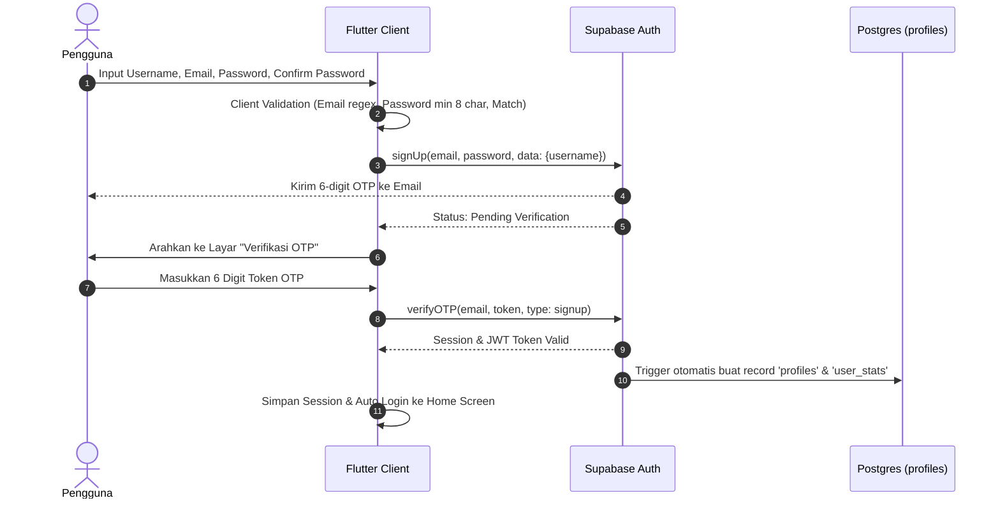
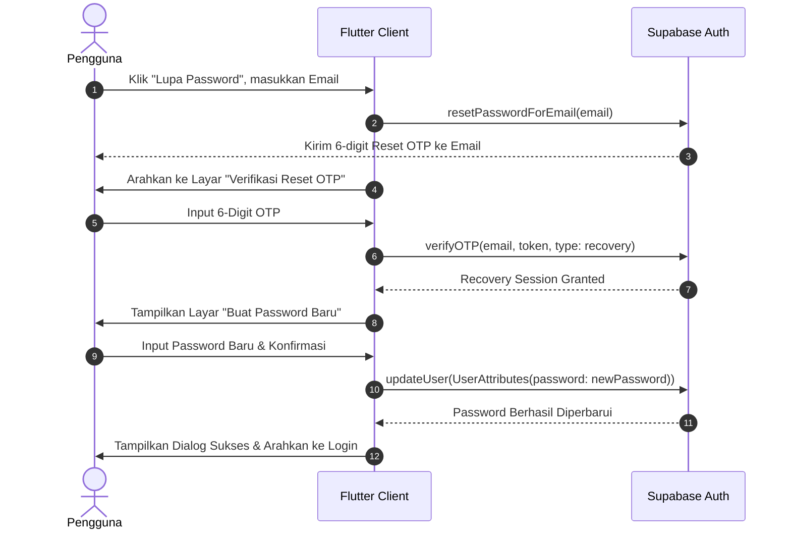

# Product Requirement Document (PRD) — Langkah

## 1. Visi Produk & Filosofi

### 1.1 Filosofi Nama "Langkah"
Nama **"Langkah"** berakar dari filosofi sederhana namun fundamental:
> *"Perjalanan seribu mil dimulai dengan satu langkah kecil yang dilakukan secara konsisten setiap hari."*

Sebagian besar sistem produktivitas gagal bukan karena kurangnya fitur, melainkan karena *over-engineering* dan beban kognitif yang terlalu tinggi (*productivity porn*). **Langkah** hadir sebagai **Personal Growth & Life OS agnostik-skill** yang dirancang tanpa distraksi, membantu individu mereduksi target-target besar (makro) menjadi aksi-aksi harian konkret (mikro) berprinsip *Atomic Habits*.

### 1.2 Visi & Nilai Inti
- **Skill-Agnostic Life OS**: Fleksibel untuk memantau berbagai domain pertumbuhan: *Software Engineering*, *Fitness/Health*, *Public Speaking*, *Reading*, hingga kebiasaan atomik sehari-hari.
- **Top-Down Clarity, Bottom-Up Execution**: Memetakan target tahunan/bulanan (*Monthly Goals*) menjadi target mingguan (*Weekly Targets*), dan mengeksekusinya sebagai tugas harian (*Daily Tasks*).
- **Distraction-Free Experience**: UI minimalis, responsif, kontras tinggi, dan minim *friction* agar pengguna fokus bertindak daripada menata aplikasi.

### 1.3 Target Pengguna
1. **Fase 1 (Internal Dogfooding)**: Penggunaan intensif oleh kreator/developer sendiri untuk mengelola seluruh aspek pertumbuhan hidup dan portofolio pribadi.
2. **Fase 2 (Public Launch / B2C)**: Profesional muda, *life-long learners*, software engineers, dan kreator konten yang membutuhkan Life OS yang terstruktur namun ringkas tanpa terjebak kompleksitas Notion/Obsidian.

---

## 2. Arsitektur UX: 3 Pilar Utama (Bottom Navigation)

Setelah pengguna berhasil melakukan autentikasi, antarmuka aplikasi **dibatasi secara ketat hanya pada 3 pilar navigasi utama** untuk menjaga fokus dan mencegah kejenuhan navigasi (*navigational fatigue*):

```
                     ┌────────────────────────┐
                     │       Main App         │
                     └──────────┬─────────────┘
                                │
        ┌───────────────────────┼───────────────────────┐
        ▼                       ▼                       ▼
┌──────────────┐        ┌──────────────┐        ┌──────────────┐
│  Pilar 1:    │        │  Pilar 2:    │        │  Pilar 3:    │
│    HOME      │        │   PLANNER    │        │   SETTINGS   │
│ (Eksekusi)   │        │(Perencanaan) │        │ (Identitas)  │
└──────────────┘        └──────────────┘        └──────────────┘
```

### 2.1 Pilar 1: Home (Beranda Eksekusi Harian)
Berfokus 100% pada **apa yang harus diselesaikan hari ini**.
- **Date & Streak Header**: 
  - Penunjuk hari, tanggal, dan bulan terkini.
  - Dynamic Progress Ring / Bar yang memperlihatkan persentase penyelesaian tugas hari ini (`x/y Langkah Selesai`).
- **Langkah Hari Ini (Daily Tasks List)**:
  - Kartu tugas interaktif dengan checkbox satu ketukan.
  - Label kategori fleksibel berwana (misal: `Coding` [Teal], `Fitness` [Orange], `Habit` [Blue]).
  - Prioritas indikator (`High`, `Medium`, `Low`).
- **Contextual Micro-Widget Area**:
  - Mini Pomodoro Timer (25/5 menit) yang dapat disematkan ke tugas aktif.
  - Habit Streak Check-in harian.
- **Quick Add Floating Action Button (FAB) `(+)`**:
  - Menampilkan *bottom sheet* instan untuk mencatat ide atau tugas baru kurang dari 3 detik (dapat langsung masuk ke *Hari Ini* atau dilempar ke *Backlog Pool*).

### 2.2 Pilar 2: Planner (Peta & Perencanaan Waktu)
Berfokus pada **tinjauan helikopter dan hierarki target**:
- **Time Horizon Toggle**:
  - Tab beralih antara **Weekly View** (rencana minggu berjalan) dan **Monthly View** (target bulan berjalan).
- **Core Goals Area**:
  - Menampilkan sasaran strategis bulanan (*Monthly Goals*) dan target minggu ini (*Weekly Targets*).
  - Memberikan visualisasi apakah tugas harian berkontribusi pada target besar atau sekadar kesibukan semu (*busywork*).
- **Backlog Pool (Inbox Mentah)**:
  - Wadah penampung ide tugas yang belum memiliki tenggat waktu/jadwal.
  - Fitur *Drag-to-Schedule* atau *Assign Date* untuk memindahkan item dari Backlog menjadi tugas harian terjadwal.

### 2.3 Pilar 3: Settings (Profil & Pengaturan)
Berfokus pada **personalisasi, data kepemilikan, dan statistik**:
- **User Profile Summary**: Avatar, nama lengkap, username, dan email akun aktif.
- **Growth & Streak Dashboard**: Total langkah yang pernah diselesaikan (*Lifetime Steps Completed*), rekor streak terpanjang, dan kalender heatmap aktivitas.
- **Theme Preferences**: Toggle Dark Mode, Light Mode, atau System Default (dengan aksen Teal `0xFF00897B`).
- **Data Governance**: Fitur ekspor data (JSON/CSV) dan sinkronisasi status Supabase.
- **Account Actions**: Ubah password, ganti avatar, dan tombol **Logout** yang aman.

---

## 3. Spesifikasi Alur Autentikasi (Supabase Auth)

Sistem autentikasi mengadopsi standar keamanan tinggi berbasis Supabase Auth dengan verifikasi email via OTP (*One-Time Password*) 6 digit, tanpa *magic link* eksternal untuk menjaga pengguna tetap di dalam aplikasi.

### 3.1 Alur Registrasi Akun (Register Flow)


### 3.2 Alur Masuk (Login Flow)
1. Pengguna memasukkan **Email** dan **Password**.
2. Validasi lokal: format email benar, password tidak boleh kosong.
3. Memanggil `supabase.auth.signInWithPassword(email: email, password: password)`.
4. Jika kredensial valid:
   - Ambil data profil dari tabel `profiles`.
   - Masuk langsung ke **Home Screen**.
5. Jika gagal:
   - Tampilkan pesan error ramah pengguna (*"Email atau password salah"* atau *"Akun belum diverifikasi"* dengan opsi kirim ulang OTP).

### 3.3 Alur Lupa Password (Forgot Password Flow)


---

## 4. Persyaratan Non-Fungsional (NFR)

1. **Performa Tinggi & Keringanan**:
   - Waktu buka awal (*Cold Start*) di bawah 1.5 detik.
   - 60/120 FPS *smooth scrolling* tanpa jank pada daftar tugas harian.
2. **Distraction-Free UI/UX**:
   - Palet warna menenangkan: Primary Teal (`#00897B`), Background Canvas (`#F5F5F5` di mode terang, `#121212` di mode gelap).
   - Tipografi yang bersih dan mudah dibaca (Roboto/Inter).
3. **Multi-User Isolation & Keamanan**:
   - 100% data diisolasi menggunakan Postgres Row Level Security (RLS) terikat `auth.uid()`.
   - Token autentikasi disimpan aman di penyimpanan terenkripsi perangkat (*flutter_secure_storage* / *shared_preferences* native).
4. **Responsivitas Layar**:
   - Kompatibel penuh untuk resolusi layar ponsel Android & iOS, serta responsif di mode tablet dan desktop wrapper.
